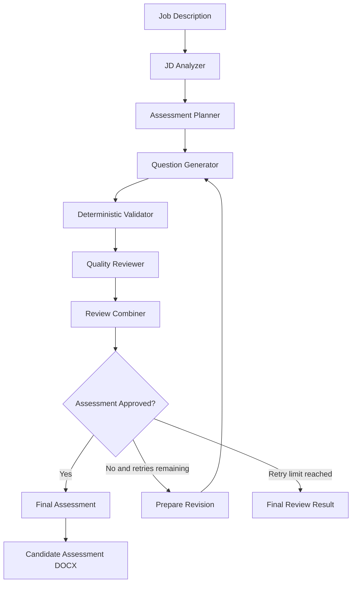

# TalentLens AI

### Agentic AI-Powered Recruitment Assessment System

TalentLens AI is an AI-powered recruitment assessment platform designed to automate the creation, validation, and quality review of technical assessments from job descriptions.

The system uses a multi-agent architecture built with LangGraph, combining LLM-powered agents with deterministic validation to generate structured, job-specific assessments while maintaining quality, consistency, and reliability.

The goal is to reduce manual effort in technical assessment design and help recruiters evaluate candidates against role-specific skills and requirements.

---

## Problem Statement

Traditional technical assessment creation is often time-consuming, repetitive, and inconsistent. Recruiters and hiring teams must manually identify relevant skills, determine assessment difficulty, design questions, establish evaluation criteria, and review the final assessment.

TalentLens AI addresses this challenge by orchestrating specialized AI agents that transform a job description into a structured, quality-reviewed technical assessment.

---

## Key Features

- **Automated Job Description Analysis:** Extracts job titles, technical skills, experience requirements, responsibilities, and qualifications from job descriptions.
- **Intelligent Assessment Planning:** Allocates questions across relevant skills, difficulty levels, question types, and assessment duration.
- **AI-Powered Question Generation:** Generates role-specific technical questions with expected answers, marks, time limits, and evaluation rubrics.
- **Deterministic Validation:** Validates assessment structure, question counts, skill allocation, and other predefined constraints using Python.
- **LLM-Based Quality Review:** Evaluates generated questions for relevance, clarity, technical correctness, and assessment quality.
- **Multi-Stage Review Pipeline:** Combines deterministic validation and AI-based quality review into a unified assessment decision.
- **Bounded Iterative Refinement:** Automatically routes rejected assessments back for revision, with a configurable retry limit.
- **Candidate Assessment Document Generation:** Produces a downloadable DOCX assessment containing candidate-facing questions without exposing expected answers or evaluation rubrics.
- **Graph-Based Agent Orchestration:** Uses LangGraph to manage agent execution, state transitions, conditional routing, and workflow control.

---

## System Architecture



---

## Multi-Agent Workflow

| Agent / Component | Responsibility | Technology |
|---|---|---|
| JD Analyzer | Extracts structured job requirements and skills from the job description | Groq |
| Assessment Planner | Creates an assessment blueprint with skill weightage, question counts, difficulty, and duration | Groq |
| Question Generator | Generates technical questions, expected answers, marks, time limits, and rubrics | Gemini |
| Deterministic Validator | Validates assessment structure and predefined constraints | Python |
| Quality Reviewer | Reviews generated questions for quality, relevance, and correctness | Gemini |
| Review Combiner | Combines deterministic and AI review results into a final decision | Python |
| Revision Controller | Routes assessments for revision while enforcing a retry limit | LangGraph |

### Workflow Design Principles

- Specialized agents have clearly defined responsibilities.
- Structured data is exchanged between agents using Pydantic schemas.
- Deterministic checks are used wherever validation can be performed programmatically.
- AI-based quality evaluation complements, rather than replaces, deterministic validation.
- Conditional routing enables automated revision cycles.
- Retry limits prevent unbounded agent execution.

---

## Technology Stack

### AI and Agent Orchestration
- LangGraph
- LangChain
- Groq API
- Google Gemini API

### Backend and Data Validation
- Python
- Pydantic
- TypedDict

### Document Generation
- python-docx

### Development and Testing
- pytest
- Mermaid
- Git
- GitHub

### Planned Interface
- Streamlit

---

## Project Structure

```text
TalentLens-AI/
│
├── app/
│   ├── agents/
│   │   ├── jd_analyzer.py
│   │   ├── assessment_planner.py
│   │   ├── question_generator.py
│   │   ├── assessment_validator.py
│   │   ├── quality_reviewer.py
│   │   └── review_combiner.py
│   │
│   ├── graph/
│   │   ├── state.py
│   │   └── workflow.py
│   │
│   ├── schemas/
│   │   ├── job_description.py
│   │   └── assessment.py
│   │
│   ├── services/
│   │   ├── llm_service.py
│   │   └── assessment_document_generator.py
│   │
│   └── config/
│       └── settings.py
│
├── tests/
│   ├── test_schemas.py
│   ├── test_question_generator.py
│   ├── test_assessment_validator.py
│   ├── test_quality_reviewer.py
│   ├── test_review_combiner.py
│   ├── test_workflow.py
│   ├── test_workflow_routing.py
│   ├── visualize_workflow.py
│   └── test_document_generator.py
│
├── outputs/
│   └── test_assessments/
│
├── main.py
├── requirements.txt
├── .env.example
├── .gitignore
└── README.md
```

---

## How the System Works

### 1. Job Description Analysis

The system receives a job description from the recruiter.

The JD Analyzer extracts structured information such as:

- Job title
- Required technical skills
- Preferred skills
- Experience requirements
- Responsibilities
- Qualifications

The extracted information is converted into a structured Pydantic model for downstream agents.

### 2. Assessment Planning

The Assessment Planner determines how the candidate should be assessed based on the requirements of the role.

It defines:

- Skills to evaluate
- Skill-wise weightage
- Number of questions per skill
- Question types
- Difficulty levels
- Total assessment duration

The plan is validated to ensure that skill weightage totals 100% and allocated question counts match the overall assessment.

### 3. Question Generation

The Question Generator creates technical questions according to the assessment plan.

Each generated question contains:

- Unique question ID
- Skill category
- Question text
- Question type
- Difficulty
- Maximum marks
- Time limit
- Expected answer
- Evaluation rubric

The generated questions are validated against the assessment schemas.

### 4. Deterministic Validation

The Deterministic Validator performs programmatic checks on the generated assessment.

It verifies predefined constraints without depending on an LLM, including assessment consistency and structural validity.

### 5. AI Quality Review

The Quality Reviewer evaluates the assessment beyond structural correctness.

It reviews the questions for issues such as:

- Technical accuracy
- Relevance to the job description
- Clarity and ambiguity
- Appropriate difficulty
- Quality of expected answers
- Alignment with the evaluation rubric

### 6. Review Combination and Routing

The Review Combiner consolidates the results of deterministic validation and AI quality review.

LangGraph then determines the next step:

- **Approved:** The assessment proceeds to the final output stage.
- **Rejected:** The assessment is routed back for revision if retries remain.
- **Retry limit reached:** The workflow terminates with its final review status.

The revision loop is bounded to prevent infinite execution.

### 7. Candidate Assessment Generation

The approved assessment is converted into a candidate-facing DOCX document.

The generated document includes:

- Assessment information
- Candidate details
- Instructions
- Technical questions
- Marks and time limits
- Space for candidate responses

Confidential evaluation information, including expected answers and internal rubrics, is excluded from the candidate-facing document.

---

## Configuration

TalentLens AI uses environment variables to configure API credentials and model settings.

Create a `.env` file in the project root:

```env
GROQ_API_KEY=your_groq_api_key
GOOGLE_API_KEY=your_google_api_key

GROQ_MODEL=openai/gpt-oss-120b
GEMINI_MODEL=gemini-3.8-flash

TEMPERATURE=0.2
MAX_TOKENS=4096
```

Never commit your `.env` file or expose API credentials publicly.

---

## Installation and Setup

### Prerequisites

- Python 3.11+
- Git
- Groq API key
- Google AI API key

### 1. Clone the repository

```bash
git clone https://github.com/Noshaba-Fatima/TalentLens-AI.git
cd TalentLens-AI
```

### 2. Create a virtual environment

Windows:

```powershell
python -m venv venv
venv\Scripts\activate
```

macOS / Linux:

```bash
python -m venv venv
source venv/bin/activate
```

### 3. Install dependencies

```bash
pip install -r requirements.txt
```

### 4. Configure environment variables

Create a `.env` file and add your API keys and model configuration.

### 5. Run the application

```bash
python main.py
```

---

## Testing

The project includes tests for individual agents, validation logic, schemas, workflow execution, routing, and document generation.

Run the test modules individually:

```bash
python -m tests.test_schemas
python -m tests.test_question_generator
python -m tests.test_assessment_validator
python -m tests.test_quality_reviewer
python -m tests.test_review_combiner
python -m tests.test_workflow
python -m tests.test_workflow_routing
python -m tests.test_document_generator
```

Or, if the tests are compatible with pytest discovery:

```bash
pytest
```

---

## Workflow Visualization

The LangGraph workflow can be visualized to understand the agent execution flow and conditional routing.

Generate the workflow visualization:

```bash
python -m tests.visualize_workflow
```

The visualization helps inspect the system's architecture, dependencies, and revision loop.

---

## Current Development Status

### Implemented

- [x] Job Description Analyzer
- [x] Assessment Planner
- [x] Question Generator
- [x] Deterministic Assessment Validator
- [x] AI Quality Reviewer
- [x] Review Combiner
- [x] LangGraph workflow orchestration
- [x] Conditional review and revision routing
- [x] Bounded revision cycles
- [x] Pydantic schemas
- [x] Agent and workflow testing
- [x] Workflow visualization
- [x] Candidate assessment DOCX generation
- [x] Candidate document confidentiality validation

### In Progress

- [ ] Candidate response extraction from submitted assessments
- [ ] Candidate answer evaluation agent
- [ ] Skill-wise candidate scoring
- [ ] Candidate performance report generation
- [ ] End-to-end candidate evaluation workflow
- [ ] Streamlit recruiter interface
- [ ] Candidate submission interface
- [ ] Assessment persistence and history

---

## Future Roadmap

The planned next phase expands TalentLens AI from assessment generation into a complete assessment and candidate evaluation lifecycle.

1. Extract candidate responses from submitted assessment documents.
2. Map candidate answers to the original assessment questions.
3. Evaluate responses using expected answers and evaluation rubrics.
4. Generate question-wise scores and feedback.
5. Aggregate skill-wise performance.
6. Generate structured candidate evaluation reports for recruiters.
7. Build a Streamlit interface for recruiters and candidates.
8. Introduce assessment history and persistent storage.
9. Add observability, execution tracing, and performance monitoring.
10. Improve evaluation reliability through testing and benchmarking.

---

## Design Philosophy

TalentLens AI follows several core engineering principles:

- **Modular agent architecture:** Each agent has a focused responsibility.
- **Structured outputs:** Pydantic schemas provide validation and predictable data contracts.
- **Hybrid intelligence:** LLM reasoning is combined with deterministic Python validation.
- **Controlled autonomy:** Conditional routing and bounded retries prevent uncontrolled execution.
- **Confidentiality:** Candidate-facing materials are separated from internal evaluation data.
- **Human-in-the-loop hiring:** AI assists recruiters but does not make final hiring decisions.

---

## Disclaimer

TalentLens AI is an experimental AI-powered recruitment assistance platform developed for educational and engineering purposes.

AI-generated assessments and candidate evaluations may contain inaccuracies, biases, or inconsistencies. Recruiters should review generated assessments and candidate reports before making employment-related decisions.

The system is intended to support human decision-making, not replace it.

---

## Author

**Noshaba Fatima**

Data Science | AI & Machine Learning | Agentic AI

GitHub: [Noshaba-Fatima](https://github.com/Noshaba-Fatima)

---

## License

This project is currently under development. A license can be added before public distribution.
